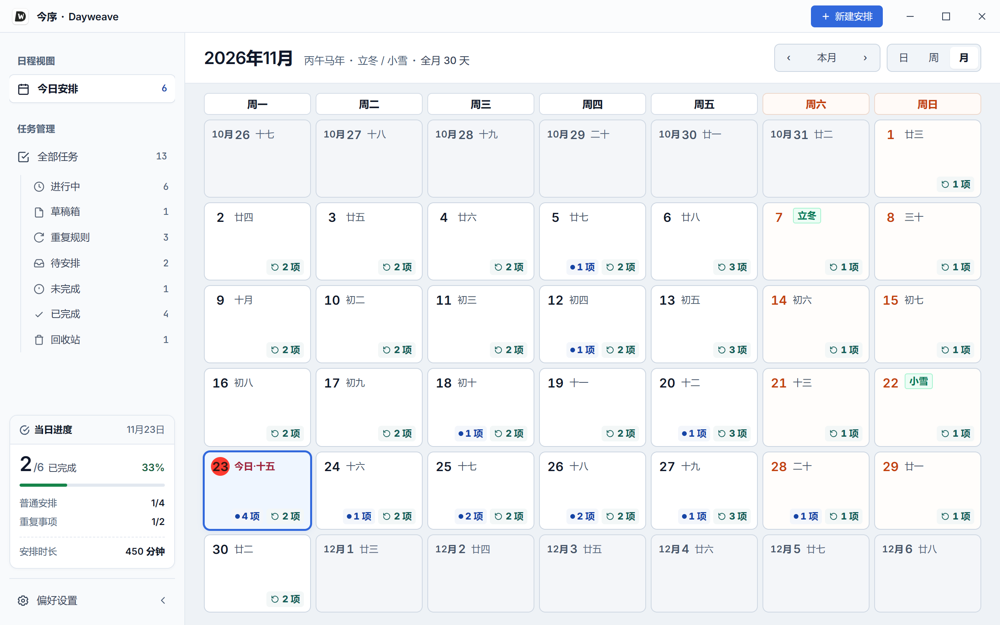
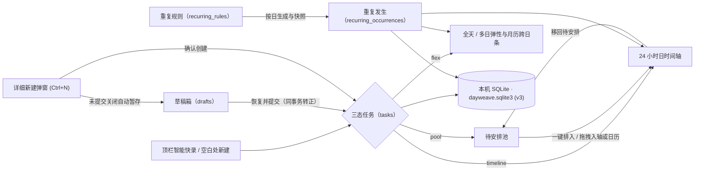

<div align="center">
  
  <h1>今序 · Dayweave</h1>
  <p>
    <strong>让今天，井然有序。</strong><br />
    <sub><em>Bring order to your day.</em></sub>
  </p>
  <p>面向 Windows 的本地优先任务与日程编织工作台 —— 把待办从清单自然编织进真实的一天，以本机 SQLite 事务守住每一步事实。</p>
  <p>
    <a href="https://github.com/haoyz629/dayweave/releases">
      
    </a>
    
    
    
    <a href="LICENSE">
      
    </a>
  </p>
  <p>
    <a href="#下载与使用">下载与使用</a> ·
    <a href="#界面一览">界面一览</a> ·
    <a href="#核心特性">核心特性</a> ·
    <a href="#快捷上手">快捷上手</a> ·
    <a href="#数据隐私与当前边界">隐私与边界</a> ·
    <a href="#从源码构建与开发">从源码构建</a> ·
    <a href="#文档索引">文档索引</a>
  </p>
</div>

<p align="center">
  
  <br />
  <sub>Win11 浅色云母工作台：顶栏智能快录、左侧图标导航与自适应任务面板（迷你日历 + 全天/多日 + 待安排池）配合 24 小时非独占时间轴。</sub>
</p>

---

## 下载与使用

> **推荐普通用户直接下载安装包使用，无需配置任何开发环境。**

1. 前往 **[GitHub Releases 页面](https://github.com/haoyz629/dayweave/releases)**，在最新版本下下载 Windows 安装程序（NSIS `.exe` 安装包）。
2. 双击运行安装程序，按向导完成安装即可启动 **今序 · Dayweave**。
3. 后续有新版本发布时，前往 **[Releases 页面](https://github.com/haoyz629/dayweave/releases)** 下载覆盖安装即可保留本机数据。

### 运行环境与数据说明

- **系统要求**：Windows 10 / 11（64 位，依赖系统内置的 Microsoft Edge WebView2 Runtime）。
- **完全离线可用**：无需注册账号或联网登录，全部任务、子任务、标签、草稿、重复规则与偏好保存在本机 `dayweave.sqlite3`。
- **旧版数据保护**：若本机存在早期 v1 数据库，首次启动新版前会自动将其备份为 `dayweave.v1.bak.sqlite3`，不会静默覆盖旧文件。

---

## 界面一览

<table>
  <tr>
    <td width="50%" valign="top">
      
      <p align="center">
        <strong>月视图 · 跨日节奏与本土节假日</strong><br />
        <sub>6×7 月历网格展示多日弹性任务的连续跨日条、农历节气与国务院「休 / 班」角标；左侧同步呈现所选日期的完整安排，并支持直接把待安排任务拖入任意日期。</sub>
      </p>
    </td>
    <td width="50%" valign="top">
      
      <p align="center">
        <strong>全部任务 · 分栏检索与右侧详情抽屉</strong><br />
        <sub>全部 / 进行中 / 待安排 / 逾期 / 已完成五分栏，配合关键词搜索、标签与 P1 / P2 优先级组合筛选，点击即在右侧滑出详情抽屉编辑子任务与排程。</sub>
      </p>
    </td>
  </tr>
  <tr>
    <td colspan="2" valign="top">
      
      <p align="center">
        <strong>偏好设置 · 修改即自动保存</strong><br />
        <sub>集成农历节气开关、5 色任务标签管理、时间轴步进与默认耗时、草稿自动暂存、法定节假日同步、WinRT 提醒与系统托盘设置。</sub>
      </p>
    </td>
  </tr>
</table>

---

## 核心特性

### 1. 三态任务编织：待安排池 / 全天多日 / 24 小时时间轴

- **先记下来，再决定何时做**：尚未定好时段的待办先放进左侧「待安排」池（支持 `全部 / P1 / 短时(≤30m)` 与标签筛选、行内调整预计耗时），不强迫每件事一创建就填满起止时刻。
- **一键排入 & 自由拖拽**：在待安排池点击「排入」自动寻找空闲时段，或直接将任务卡片拖拽到时间轴具体时刻、迷你日历日期或月历任意日期格。
- **全天与多日弹性**：不占具体钟表时段的单日或跨日事项置顶显示在「全天 / 多日」区（带 `第 X/Y 天` 进度），并在月视图中自动绘制连续跨日条。

### 2. 24 小时非独占日时间轴与本土日历

- **允许重叠，尊重真实日程**：多个任务块与定时重复事项可以在同一时段并列排布（自动等宽分列），不将重叠当作冲突报错。
- **丝滑调时与就地新建**：支持整块上下拖动与上下边缘拉伸调整时长（`15 / 30` 分钟吸附，按住 `Alt` 5 分钟微调），也支持在时间轴空白处直接拖动或双击就地新建。
- **农历、节气与法定节假日**：内置 `2026` 年中国法定节假日与调休补班兜底数据，支持通过 jsDelivr（`NateScarlet/holiday-cn`）按年份增量更新并离线缓存，同步驱动日/月历「休 / 班」角标与「法定工作日」重复规则。

### 3. 子任务、草稿箱、重复规则与 30 天回收站

- **子任务与「下一步」预览**：在右侧 `360px` 详情抽屉中拆解并勾选子任务，日时间轴任务块同步显示子任务进度与下一项待做步骤；未保存修改离开时提供保护确认。
- **防丢失草稿箱**：开启自动暂存后，关闭未提交的新建弹窗会自动存入左侧草稿箱抽屉，恢复提交时在同一 SQLite 事务内转正并移除草稿。
- **按日快照重复规则**：支持**每天**、**每个法定工作日**、**每周多选**、**每月固定日** 4 种频率，以及时间轴 / 全天两种形态；拖动重复事项时明确询问**「仅调整本次」**或**「调整本次及未来安排」**，自动冻结历史日期快照，历史记录不漂移。
- **30 天回收站 & 10 秒撤销**：删除任务进入 30 天回收站（到期自动清理，支持随时恢复与二次确认彻底删除）；完成切换、排入、移回待安排、移入回收站、跳过/单次调整重复事项均提供 10 秒白卡撤销条（`Ctrl+Z`）。

### 4. Windows 原生桌面体验

- **Win11 浅色云母视觉**：`48px` 无边框集成标题栏、`56px` 左侧图标导航、高对比浅色陶瓷卡片，配合自定义窗口控制与单实例运行保护。
- **WinRT 原生提醒与系统托盘**：支持关闭窗口最小化到托盘与开机自启；为当日时间轴任务提供开始前/结束前 `0–60` 分钟桌面通知，通知内可直接「打开今序」「快捷完成」「稍后提醒」或「我知道了」。

---

## 快捷上手

### 顶栏智能快录语法

在顶部居中输入框中键入标题并回车即可创建任务；以空格分隔可附带快捷指令（输入 `#`、`/` 或点击 `?` 可查看提示）：

| 语法示例 | 效果 |
| --- | --- |
| `整理周报` | 创建到「待安排」池（使用默认预计耗时） |
| `评审方案 14:30 1.5h` | 直接排入所选日期时间轴 `14:30–16:00`（支持 `45m` / `1.5h` 与中英文冒号） |
| `准备季度材料 #全天` | 创建为当日「全天 / 多日」弹性任务（也支持 `#不限时`） |
| `修复导出异常 #P1 #工作` | 标记 `P1` 紧急优先级（另支持 `#P2`）并绑定已有的 `#工作` 标签 |

### 常用快捷键

| 快捷键 | 作用 |
| --- | --- |
| `Ctrl + N` | 打开详细新建任务弹窗 |
| `Ctrl + S` | 在右侧任务详情抽屉中保存修改 |
| `Ctrl + Z` | 撤销最近 10 秒内的可撤销操作（非文本输入状态） |
| `Alt + 拖动/拉伸` | 在时间轴上以 5 分钟粒度微调时间或时长 |
| `Esc` | 关闭当前浮层、弹窗、抽屉或取消正在进行的拖拽 |

---

## 数据隐私与当前边界

- **本机优先与隐私**：所有任务、子任务、标签、草稿、重复规则与偏好设置均保存在本机 Tauri 应用数据目录的 `dayweave.sqlite3`（SQLite WAL 模式，Rust 事务校验提交）。除可选的公开法定节假日年度 JSON 更新外，应用不发起其他网络请求，不收集任何个人数据或遥测。
- **当前版本边界**：
  - 当前聚焦**浅色模式**开发与验收（暗色模式暂缓）。
  - 当前不包含云端账号同步、外部日历集成、AI 助手、周视图或应用内自动更新。

---

## 从源码构建与开发

> 以下内容面向希望自行编译、调试或参与开发的贡献者；日常使用请直接前往 [GitHub Releases](https://github.com/haoyz629/dayweave/releases) 下载安装包。

### 技术架构

| 维度 | 实现 |
| --- | --- |
| **桌面框架** | Tauri v2（Rust 原生后端 + 系统托盘 + 单实例 + 开机自启 + WinRT 通知） |
| **前端工作台** | React 18 + TypeScript + Win11 Fluent 浅色云母样式体系 |
| **本地持久化** | 本机 SQLite（`rusqlite` bundled，Schema v3，Rust 事务校验） |
| **时区与日历** | 简体中文 · 北京时间（`Asia/Shanghai`）、农历、二十四节气、2026 内置法定节假日 |
| **应用标识 / 库名** | `com.dayweave.desktop` · `dayweave.sqlite3` |

<details>
<summary>展开查看领域数据流图、构建验证命令与目录结构</summary>

#### 领域数据流



#### 环境准备

- Windows 10 / 11（含 WebView2 Runtime）
- Node.js 22+（支持 `--experimental-strip-types`）
- Rust 工具链（`cargo` / `rustc`）

#### 开发、测试与打包命令

```powershell
# 安装依赖并启动 Tauri 桌面开发环境（仅浏览器预览可运行 npm run dev）
npm install
npm run tauri:dev

# TypeScript 类型检查与前端构建
npm run build

# 运行前端单元测试
npm run test:frontend

# 运行隔离浏览器交互回归（core / calendar / trash / consistency，需 Chrome 或 Edge）
npm run test:interactions

# 校验内置法定节假日兜底数据
node --experimental-strip-types scripts/validate-holidays.mjs

# 运行 Rust 后端与 SQLite 事务测试
npm run test:rust

# 构建 Windows NSIS 安装包（Debug / Release）
npm run tauri:build -- --debug
npm run tauri:build
```

> 交互测试使用临时浏览器配置与模拟 Tauri IPC，不触碰真实数据库；若浏览器不在标准目录，可设置 `DAYWEAVE_TEST_CHROME` 指向可执行文件。

#### 目录结构

```text
dayweave/
├── src/
│   ├── components/     # 工作台左栏、日时间轴、月视图、全部任务、重复规则、回收站、设置、抽屉与弹窗
│   ├── styles/         # tokens / shell / workbench / modules / overlays / controls 分层样式
│   ├── types/          # 前后端共享类型定义（dayweave.ts）
│   ├── utils/          # 快录解析、重叠分列、跨日条布局、日期农历、回收站倒计时与单元测试
│   └── assets/         # 字体（Inter / JetBrains Mono / Source Serif 4）与品牌图标资源
├── src-tauri/          # Tauri v2 Rust 后端、SQLite v3 事务与迁移、WinRT 提醒、节假日同步与托盘
├── data/holidays/      # 内置法定节假日年度兜底 JSON（2026.json）
├── scripts/            # 隔离浏览器交互回归（test-interactions.cjs）与节假日校验脚本
└── docs/               # 架构决策记录（ADR）、节假日维护说明、界面预览与历史基线文档
```

</details>

---

## 文档索引

| 类别 | 文档 |
| --- | --- |
| **产品与设计（现行）** | [产品介绍](dayweave-product-overview.md) · [产品定位](PRODUCT.md) · [领域术语](CONTEXT.md) · [设计规范](DESIGN.md) |
| **架构决策（ADR）** | **[0008 统一云母工作台与三态调度（现行）](docs/adr/0008-unified-mica-workbench-and-three-mode-scheduling.md)** · [0003 非独占时间线（延续有效）](docs/adr/0003-adopt-non-exclusive-daily-timeline.md) · 历史决策：[0001](docs/adr/0001-persist-drafts-before-confirmed-writes.md) / [0002](docs/adr/0002-separate-tasks-from-daily-execution.md) / [0004](docs/adr/0004-require-complete-task-time-and-remove-inbox.md) / [0005](docs/adr/0005-single-day-direct-scheduling.md) / [0007](docs/adr/0007-lightweight-review-and-backfill.md) |
| **维护与历史档案** | [节假日数据维护](docs/holiday-calendar-maintenance.md) · [历史冻结方案](docs/product-decision-baseline-2026-08-21.md) · [历史车道设计](docs/design-apple-inspired-timeline-lanes-2026-09-04.md) · [历史前端需求](docs/frontend-requirements.md) · [历史实施规格](ai-todolist-implementation-spec.md) |

---

## 开源协议

本项目基于 [Apache License 2.0](LICENSE) 开源。
