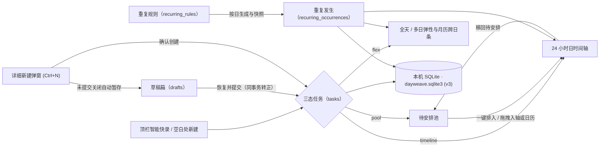

<div align="center">
  
  <h1>今序 · Dayweave</h1>
  <p>
    <strong>让今天，井然有序。</strong><br />
    <sub><em>Bring order to your day.</em></sub>
  </p>
  <p>面向 Windows 的本地优先任务与日程编织工作台 —— 用「待安排 / 全天多日 / 时间轴」三态调度把待办自然编织进真实的一天，以 SQLite 事务守住每一步事实。</p>
  <p>
    
    
    
    
    
  </p>
  <p>
    <a href="#界面一览">界面一览</a> ·
    <a href="#核心能力">核心能力</a> ·
    <a href="#领域流程与数据架构">领域流程与数据架构</a> ·
    <a href="#本地数据与使用边界">使用边界</a> ·
    <a href="#开发与验证">开发与验证</a> ·
    <a href="#文档索引">文档索引</a>
  </p>
</div>

<p align="center">
  
  <br />
  <sub>Win11 浅色云母工作台：48px 集成顶栏与智能快录栏、56px 左侧图标导航、318px 自适应左栏（迷你日历 + 全天/多日 + 待安排池）与 24 小时非独占时间轴。</sub>
</p>

## 从待办，到真实的一天

任务不只是清单上的一行字。**今序 · Dayweave** 将智能快录、待安排池、全天/多日弹性任务、24 小时日时间线、跨日月历与按日快照重复规则连成一个本地优先的桌面工作台：随手记下待办，一键或拖拽编织进具体时段，拆解子任务并就地完成，同时通过月历把握跨日节奏。

---

## 界面一览

<table>
  <tr>
    <td width="50%" valign="top">
      
      <p align="center">
        <strong>月视图 · 跨日任务条与本土节假日</strong><br />
        <sub>6×7 月历网格支持多日弹性任务跨日条、农历节气与国务院「休 / 班」角标；左侧同步展示所选日期完整安排清单与待安排池，可直接拖入任意日期。</sub>
      </p>
    </td>
    <td width="50%" valign="top">
      
      <p align="center">
        <strong>全部任务 · 状态分栏与快速编织</strong><br />
        <sub>全部 / 进行中 / 待安排 / 逾期 / 已完成五分栏，支持关键词搜索、标签与 P1/P2 优先级组合筛选，单击打开右侧详情抽屉实时编辑。</sub>
      </p>
    </td>
  </tr>
  <tr>
    <td colspan="2" valign="top">
      
      <p align="center">
        <strong>偏好设置 · 自动保存的一体化配置页</strong><br />
        <sub>涵盖农历节气开关、5 色任务标签管理、时间轴步进与默认耗时、草稿自动暂存、年度法定节假日同步、WinRT 提醒与系统托盘选项。</sub>
      </p>
    </td>
  </tr>
</table>

---

## 核心能力

### 1. 三态任务编织：待安排池 / 全天多日 / 24 小时时间轴（[ADR-0008](docs/adr/0008-unified-mica-workbench-and-three-mode-scheduling.md)）

- **顶栏智能快录**：`48px` 半透明集成顶栏居中常驻快录栏，输入标题回车即创建，并自动解析快捷语法：
  - `17:00`（或 `17：00`）直接排入所选日期时间轴；`#全天` / `#不限时` 设为全天弹性任务；未指定时间则进入待安排池；
  - `45m` / `1.5h` 解析预计耗时；`#P1` / `#P2` 标记优先级；`#标签名` 自动绑定对应彩色标签；
  - 输入 `#`、`/` 或点击 `?` 可呼出语法提示浮层，点击「详细」或按 `Ctrl+N` 打开详细新建弹窗。
- **自适应左栏（`318px`）**：
  - **日视图**：顶部为可展开/收起的迷你周/月历（含任务圆点提示），中部固定置顶当日「全天 / 多日」弹性事项（显示 `第 X/Y 天` 进度），下方为可滚动的「待安排」池（支持 `全部 / P1 / 短时(≤30m)` 与标签筛选、行内快捷改耗时、一键「排入」自动寻找空闲时段，或直接指针拖拽至时间轴、迷你日历或月历任意日期格）。
  - **月视图**：顶部自动切换为所选日期的「当日安排」预览清单（含「进日视图 →」入口），下方继续保留待安排池方便跨日拖拽排期。
- **24 小时非独占日时间轴（[ADR-0003](docs/adr/0003-adopt-non-exclusive-daily-timeline.md)）**：
  - 任务块与定时重复事项可在同一时段并列排布，采用连通分量等宽分列，不因重叠阻断排程；
  - 实时蓝线标注当前时刻，头部展示农历/节气副标题与当日完成进度条；
  - 支持整块上下拖动与上下边缘拉伸改时长（按 `15 / 30` 分钟步进吸附，按住 `Alt` 可 `5` 分钟微调，最短 `15` 分钟）；
  - 支持时间轴空白处拖动框选或双击就地新建，以及悬停「移回待安排」；任务块展示标签色、优先级、备注摘要、子任务进度与「下一步」预览。
- **月视图与跨日条**：`6×7` 月历网格展示多日弹性任务的连续跨日条（每周最多 2 条车道并统计折叠数）、公历/农历/二十四节气进度与国务院放假/补班（「休 / 班」）角标；单击同步左栏安排，双击进入当日时间轴。

### 2. 全链路任务管理：详情抽屉、子任务、草稿箱与回收站

- **左侧 `56px` 图标导航栏**：清晰聚合「日程（日/月）」、「全部任务」、「草稿箱抽屉（带角标）」、「重复规则」、「回收站（带角标）」与「设置」。
- **右侧滑出详情抽屉（`360px`）**：点击任意任务展开，支持实时预览变更、`Ctrl+S` 保存、未保存修改离开保护、三态排程切换、子任务拆解勾选、5 色单标签绑定（至少保留 1 个标签）与移入回收站。
- **草稿箱抽屉（`336px`）与自动暂存**：开启自动暂存后，按 `Esc`、点击关闭按钮或遮罩退出未提交的详细新建弹窗时自动保存草稿；从草稿箱恢复并正式提交时，在同一 SQLite 事务内创建任务并移除草稿。
- **30 天回收站**：软删除任务默认保留 30 天并实时显示剩余倒计时，启动时自动清理过期条目；支持恢复原状、单条彻底删除与清空回收站（均配二次确认弹窗）。
- **关键操作 10 秒撤销**：任务完成切换、排入时间轴、移回待安排、移入回收站、跳过当日重复及单次重复调时均弹出白卡撤销条，支持点击撤销或 `Ctrl+Z`。

### 3. 独立重复规则与按日历史快照

- 支持**每天**、**每个法定工作日**（遵循法定节假日与调休补班）、**每周**（任意星期多选）与**每月**（固定日期）4 种频率，可设为时间轴时段或全天弹性，并配置生效起止日期。
- 支持启用/暂停、编辑、归档与恢复；历史发生记录以独立快照持久化，暂停、编辑或归档规则不会抹掉已有完成记录。
- 在时间轴拖动或拉伸重复事项时，弹出作用域确认弹窗：可选择**「仅调整本次」**（仅覆盖当日，支持 10 秒撤销）或**「调整本次及未来安排」**（自动冻结该日之前最多 366 天内的未记录历史快照，再原地更新单一规则，历史不漂移且不分裂规则）。

### 4. Windows 原生桌面体验与节假日同步

- **无边框桌面壳与系统集成**：`48px` 可拖动集成标题栏、系统托盘与关闭最小化到托盘、开机自启、单实例运行保护，默认窗口 `1280×800`（最小 `960×640`）。
- **WinRT 原生桌面通知**：为当日未完成的时间轴任务提供开始前与结束前 `0–60` 分钟提醒（可关闭或发送测试通知）；通知内置「打开今序」（跳转至对应日期并打开任务详情）、「快捷完成」（结束提醒）、「稍后提醒」与「我知道了」操作。
- **法定节假日数据与离线兜底**：内置 `2026` 年中国法定节假日及调休安排，后台与设置页均支持通过 jsDelivr（`NateScarlet/holiday-cn`）按年份增量更新并离线缓存；未覆盖年份如实提示，不猜测调休（详见 [节假日数据维护](docs/holiday-calendar-maintenance.md)）。

---

## 领域流程与数据架构



| 维度 | 当前实现 |
| --- | --- |
| **桌面框架** | Tauri v2（Rust 原生后端 + 系统托盘 + 单实例 + 开机自启 + WinRT 通知） |
| **前端工作台** | React 18 + TypeScript + Win11 Fluent 浅色云母设计体系 |
| **数据持久化** | 本机 SQLite（`rusqlite` bundled，WAL 模式，Schema v3，Rust 事务校验提交） |
| **时区与日历** | 简体中文 · 北京时间（`Asia/Shanghai`）、农历、二十四节气、2026 内置法定节假日 |
| **应用标识 / 库名** | `com.dayweave.desktop` · `dayweave.sqlite3` |

---

## 本地数据与使用边界

- 任务、子任务、标签、草稿、重复规则与偏好设置全部保存在本机 Tauri 应用数据目录中的 `dayweave.sqlite3`，除可选的法定节假日 JSON 更新检查外不发起外部网络请求。
- 若从早期 v1 数据库升级，程序会在首次打开时自动将旧库备份为 `dayweave.v1.bak.sqlite3`，再初始化 v3 数据结构，不静默覆盖旧文件。
- 当前版本聚焦**浅色模式**开发与验收（暗色模式暂缓）；不提供账号、云同步、外部日历、AI 助手、周视图或应用内自动更新。

---

## 开发与验证

### 环境准备

- Windows 10 / 11（含 WebView2 Runtime）
- Node.js 22+（支持 `--experimental-strip-types`）
- Rust 工具链（`cargo` / `rustc`）

### 安装依赖与启动开发环境

```powershell
npm install
npm run tauri:dev
```

> 仅在浏览器中预览界面（使用 `localStorage` 演示数据，不连接本机 SQLite）可运行 `npm run dev`。

### 构建与测试命令

```powershell
# TypeScript 类型检查与前端构建
npm run build

# 运行前端单元测试（工作台逻辑、农历、节假日解析、Logo 资源）
npm run test:frontend

# 运行隔离浏览器交互回归（core / calendar / trash / consistency 四套件，需 Chrome 或 Edge）
npm run test:interactions

# 校验内置法定节假日兜底数据
node --experimental-strip-types scripts/validate-holidays.mjs

# 运行 Rust 后端与 SQLite 事务测试
npm run test:rust

# 构建 Windows Debug 安装包（NSIS）
npm run tauri:build -- --debug
```

交互测试使用临时浏览器配置与模拟 Tauri IPC，不打开原生程序或真实数据库；若浏览器不在标准安装目录，可设置 `DAYWEAVE_TEST_CHROME` 指向可执行文件。

---

## 项目结构

```text
dayweave/
├── src/
│   ├── components/     # 工作台左栏、日时间轴、月视图、全部任务、重复规则、回收站、设置、抽屉与弹窗
│   ├── styles/         # tokens / shell / workbench / modules / overlays / controls 分层样式
│   ├── types/          # 前后端共享类型定义（dayweave.ts）
│   ├── utils/          # 快录解析、重叠分列、跨日条布局、日期农历、回收站倒计时与单元测试
│   └── assets/         # 字体（Inter / JetBrains Mono / Source Serif 4）与品牌图标资源
├── src-tauri/          # Tauri v2 Rust 后端、SQLite v3 事务与迁移、WinRT 提醒、节假日同步与托盘
├── data/holidays/      # 内置法定节假日年度兜底 JSON（2026.json）
├── scripts/            # 隔离浏览器交互回归（test-interactions.cjs）与节假日校验脚本
└── docs/               # 架构决策记录（ADR）、节假日维护说明、界面预览与历史基线文档
```

---

## 文档索引

| 类别 | 文档 |
| --- | --- |
| **产品与设计（现行）** | [产品介绍](dayweave-product-overview.md) · [产品定位](PRODUCT.md) · [领域术语](CONTEXT.md) · [设计规范](DESIGN.md) |
| **架构决策（ADR）** | **[0008 统一云母工作台与三态调度（现行）](docs/adr/0008-unified-mica-workbench-and-three-mode-scheduling.md)** · [0003 非独占时间线（延续有效）](docs/adr/0003-adopt-non-exclusive-daily-timeline.md) · 历史决策：[0001](docs/adr/0001-persist-drafts-before-confirmed-writes.md) / [0002](docs/adr/0002-separate-tasks-from-daily-execution.md) / [0004](docs/adr/0004-require-complete-task-time-and-remove-inbox.md) / [0005](docs/adr/0005-single-day-direct-scheduling.md) / [0007](docs/adr/0007-lightweight-review-and-backfill.md) |
| **维护与历史档案** | [节假日数据维护](docs/holiday-calendar-maintenance.md) · [历史冻结方案](docs/product-decision-baseline-2026-08-21.md) · [历史车道设计](docs/design-apple-inspired-timeline-lanes-2026-09-04.md) · [历史前端需求](docs/frontend-requirements.md) · [历史实施规格](ai-todolist-implementation-spec.md) |
