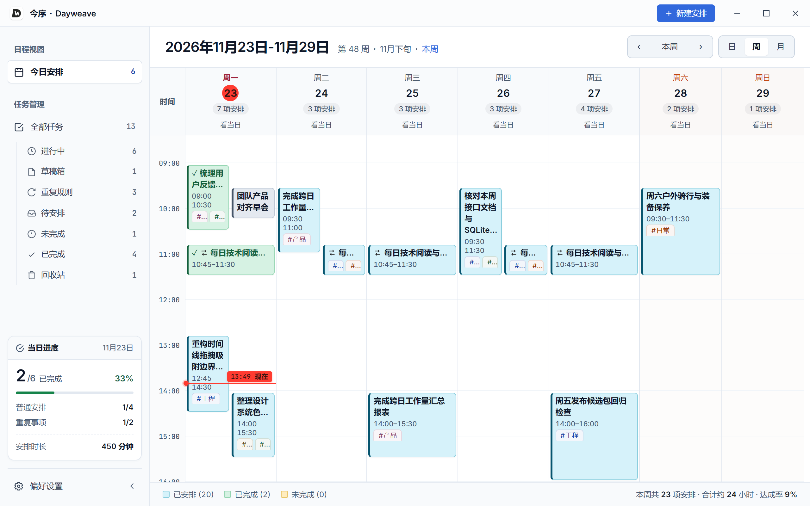
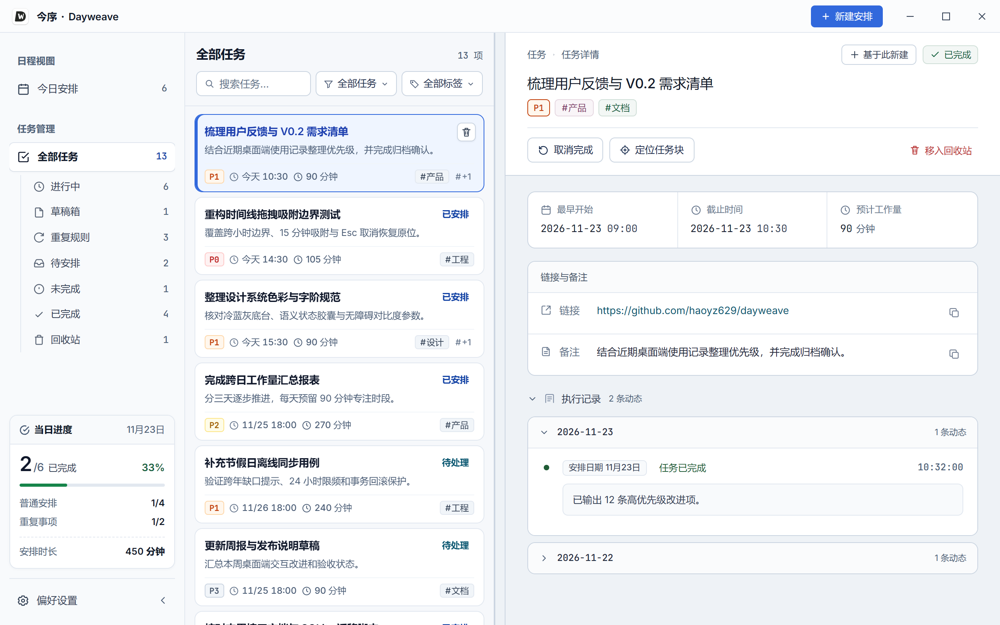
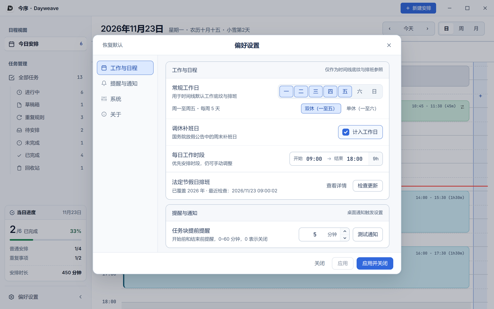
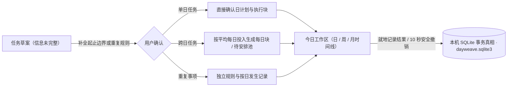

<div align="center">
  
  <h1>今序 · Dayweave</h1>
  <p>
    <strong>让今天，井然有序。</strong><br />
    <sub><em>Bring order to your day.</em></sub>
  </p>
  <p>面向 Windows 的本地优先任务与日程工作台 —— 把待办安排进真实的一天，以 SQLite 事务守住每一步事实。</p>
  <p>
    
    
    
    
    
  </p>
  <p>
    <a href="#界面一览">界面一览</a> ·
    <a href="#核心能力">核心能力</a> ·
    <a href="#领域流程与数据架构">领域流程与数据架构</a> ·
    <a href="#本地数据与使用边界">使用边界</a> ·
    <a href="#开发与验证">开发与验证</a> ·
    <a href="#文档索引">文档索引</a>
  </p>
</div>

<p align="center">
  
  <br />
  <sub>Precision Workbench 浅色工作台：42px 集成顶栏、可收起侧栏与「当日进度」看板、24 小时非独占车道时间线与右侧框选新建轨。</sub>
</p>

## 从待办，到真实的一天

任务不只是清单上的一行字。**今序 · Dayweave** 将日程时间线、任务账本、重复规则与按需执行记录连成一个本地优先的桌面工作台：先记下待办，再为它留出真实时段，执行后就地记录结果，并在需要时通过周、月视角把握整体节奏。

---

## 界面一览

<table>
  <tr>
    <td width="50%" valign="top">
      
      <p align="center">
        <strong>周视图 · 7 日共享时间线</strong><br />
        <sub>全周负载对比、实时状态汇总图例、悬停摘要卡与周详情抽屉快速定位。</sub>
      </p>
    </td>
    <td width="50%" valign="top">
      
      <p align="center">
        <strong>月视图 · 农历节气与休 / 班月历</strong><br />
        <sub>6×7 圆角白卡矩阵、二十四节气标签、国务院放假 / 补班角标与每日计数胶囊。</sub>
      </p>
    </td>
  </tr>
  <tr>
    <td width="50%" valign="top">
      
      <p align="center">
        <strong>任务工作区 · 双栏可调账本</strong><br />
        <sub>可拖曳分栏宽度的任务队列、P0–P3 优先级、标签筛选、备注链接提取与执行历史。</sub>
      </p>
    </td>
    <td width="50%" valign="top">
      
      <p align="center">
        <strong>偏好设置 · 工作日、节假日与桌面提醒</strong><br />
        <sub>常规工作日与工作时段参照、年度节假日同步、WinRT 提醒与系统托盘选项。</sub>
      </p>
    </td>
  </tr>
</table>

---

## 核心能力

### 1. 看清每一天：「今日」日 / 周 / 月三视图

- **日视图（24 小时非独占时间线）**：任务块、固定日程与定时重复事项可以在同一时段并列排布，不强行独占钟表时间也不形成卡片嵌套；实时红线与「回到现在」锚定当前时刻；上方「待安排池」支持一键加入时间线，普通任务块支持 15 分钟吸附拖拽调时，右侧 `28px` 窄轨支持直接框选创建当日安排。
- **周视图（7 日共享网格）**：工作日与周末区分列宽并高亮今日红标；底部汇总图例栏实时统计已安排、已完成、未完成数量、本周总时长与达成率；点击日期列头或事项卡片打开周详情抽屉，可直达任务详情或定位到当日时间线。
- **月视图（本土日历与节假日感知）**：`6×7` 独立圆角白卡矩阵展示公历、农历、二十四节气进度（如「小雪第2天」）、传统/法定节日与「休 / 班」角标；单击选中日期即同步左侧「当日进度」看板，双击或按 `Enter` 进入当日日视图。

### 2. 把任务安排进时间：「任务」双栏工作区

- **全局新建与侧栏导航**：顶栏常驻「新建安排 (`Ctrl+N`)」入口，左侧边栏可收起为 `52px` 窄轨，聚合「今日安排」、「全部任务」与 7 类任务状态视图（进行中、草稿箱、重复规则、待安排、未完成、已完成、回收站），底部固定展示所选日期的「当日进度」看板。
- **同入口双形态与自动草稿**：新建表单可在「普通任务」与「重复事项」间直接切换并保留已填公共字段；编辑停顿后自动暂存草稿，切换任务或离开视图前自动保护。
- **单日直排与跨日工作量（[ADR-0005](docs/adr/0005-single-day-direct-scheduling.md)）**：正式任务要求填写完整起止日期与时间（信息不完整时暂存为草稿）。今天及未来的单日任务保存即在同一事务内直接确认日计划与任务块；新建跨日任务按自然日范围与平均每日投入自动生成每日块，剩余投入仍可从待安排池加入。
- **语义标记与生命周期**：提供 `P0–P3` 语义优先级、自定义彩色标签与组合筛选、全文搜索、备注链接提取与一键打开、状态/执行历史时间线，以及 30 天回收站（支持恢复与二次确认永久删除）。

### 3. 给重复的事留好位置：独立规则与按日发生

- 支持**每天**（所有自然日 / 仅法定工作日）、**每周**（任意星期多选）与**每月**（固定日期）规则，可配置长期有效或自定义起止日期范围并实时预览近期发生日期。
- 每次发生保存独立的执行结果与备注；修改重复规则时提供作用域确认，不覆盖既有历史执行记录。

### 4. 就地记录与 Windows 原生集成

- **轻量记录与 10 秒安全撤销（[ADR-0007](docs/adr/0007-lightweight-review-and-backfill.md)）**：在时间线任务块弹窗或任务详情中按需记录本次结果与备注；「完成一个任务块」与「完成整个任务」相互独立；日常加入、移除、调时与完成操作提供 10 秒事务级撤销，且拒绝覆盖后续修改或执行事实。
- **Windows 桌面体验**：`42px` 无边框集成顶栏、系统托盘与关闭到托盘、开机自启、单实例运行保护，以及任务块开始前 / 结束前 `0–60` 分钟 WinRT 原生桌面通知（点击通知可直接跳转到对应日期与任务块）。
- **法定节假日数据与离线兜底**：内置 `2026` 年中国法定节假日及调休安排，支持通过 jsDelivr（`NateScarlet/holiday-cn`）按年份增量更新并离线缓存；未覆盖年份如实提示，不猜测调休（详见 [节假日数据维护](docs/holiday-calendar-maintenance.md)）。

---

## 领域流程与数据架构



| 维度 | 当前实现 |
| --- | --- |
| **桌面框架** | Tauri v2（Rust 原生后端 + 系统托盘 + 单实例 + WinRT 通知） |
| **前端工作台** | React 18 + TypeScript + Precision Workbench 浅色冷蓝灰设计体系 |
| **数据持久化** | 本机 SQLite（`rusqlite` bundled，Rust 事务校验后重读刷新，无乐观假状态） |
| **时区与日历** | 简体中文 · 北京时间（`Asia/Shanghai`）、农历、二十四节气、2026 内置法定节假日 |
| **应用标识 / 库名** | `com.dayweave.desktop` · `dayweave.sqlite3` |

---

## 本地数据与使用边界

- 数据保存在本机 Tauri 应用数据目录中的 `dayweave.sqlite3`，全部正式写入由 Rust 事务提交后才更新界面。
- 常规工作日与每日工作时段仅作为时间线底纹和排班参照，不限制在其他时段安排事项。
- 当前版本聚焦**浅色模式**开发与验收（暗色模式暂缓）；不提供账号、云同步、外部日历或自动更新。
- 当前界面不提供 AI 助手浮窗、AI 连接设置、独立的「复盘与记录」入口或主题/字号切换；仓库后端仍保留相关历史模块与数据兼容能力。
- 原有设计中的 API Key 字段在数据库规格中以明文保存在本机 SQLite，请妥善保护数据库文件。

---

## 开发与验证

### 环境准备

- Windows 10 / 11（含 WebView2 Runtime）
- Node.js（支持 `--experimental-strip-types`）
- Rust 工具链（`cargo` / `rustc`）

### 安装依赖与启动开发环境

```powershell
npm install
npm run tauri:dev
```

### 构建与测试命令

```powershell
# TypeScript 类型检查与前端构建
npm run build

# 运行前端与设计约束测试
node --experimental-strip-types --test src/*.test.mjs

# 校验内置法定节假日兜底数据
node --experimental-strip-types scripts/validate-holidays.mjs

# 运行 Rust 后端与 SQLite 事务测试
npm run test:rust

# 构建 Windows Debug 安装包（NSIS）
npm run tauri:build -- --debug
```

---

## 项目结构

```text
dayweave/
├── src/                # React + TypeScript 工作台界面、时间线车道、日/周/月视图与前端测试
├── src-tauri/          # Tauri v2 Rust 后端、SQLite 事务与迁移、WinRT 通知、托盘与图标资源
├── data/holidays/      # 内置法定节假日年度兜底 JSON（2026.json）
├── scripts/            # 节假日数据校验等辅助脚本
└── docs/               # 架构决策记录（ADR）、节假日维护说明、设计基线与验收记录
```

---

## 文档索引

| 类别 | 文档 |
| --- | --- |
| **产品与设计** | [产品介绍](dayweave-product-overview.md) · [产品定位](PRODUCT.md) · [领域术语](CONTEXT.md) · [设计规范](DESIGN.md) |
| **维护与基线** | [节假日数据维护](docs/holiday-calendar-maintenance.md) · [冻结产品方案](docs/product-decision-baseline-2026-08-21.md) · [非独占车道设计](docs/design-apple-inspired-timeline-lanes-2026-09-04.md) · [历史前端需求](docs/frontend-requirements.md) · [历史实施规格](ai-todolist-implementation-spec.md) |
| **架构决策（ADR）** | [0001 草案持久化](docs/adr/0001-persist-drafts-before-confirmed-writes.md) · [0002 任务与执行分离](docs/adr/0002-separate-tasks-from-daily-execution.md) · [0003 非独占时间线](docs/adr/0003-adopt-non-exclusive-daily-timeline.md) · [0004 完整时间边界](docs/adr/0004-require-complete-task-time-and-remove-inbox.md) · [0005 单日直接安排](docs/adr/0005-single-day-direct-scheduling.md) · [0007 轻量记录与补录](docs/adr/0007-lightweight-review-and-backfill.md) |
| **验收记录** | [非独占时间线](docs/acceptance-non-exclusive-daily-timeline-2026-09-03.md) · [任务编辑器与时间范围](docs/acceptance-task-editor-time-range-2026-09-17.md) · [轻量复盘与补录](docs/acceptance-lightweight-review-2026-10-16.md) · [任务结果操作](docs/acceptance-task-result-actions.md) |
